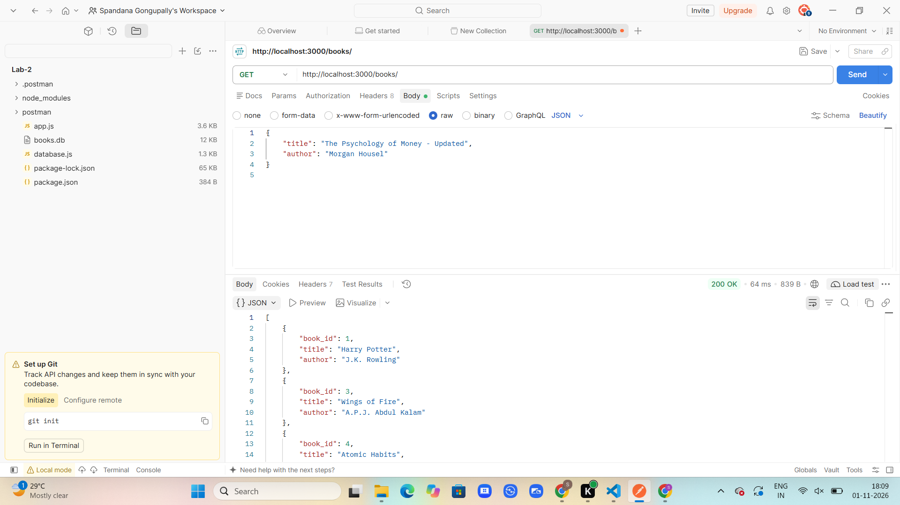
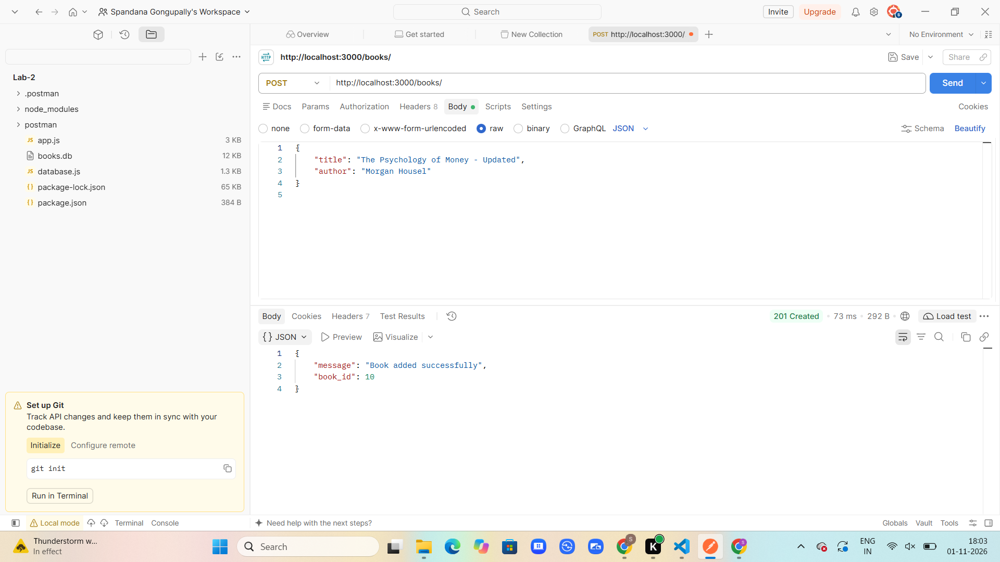
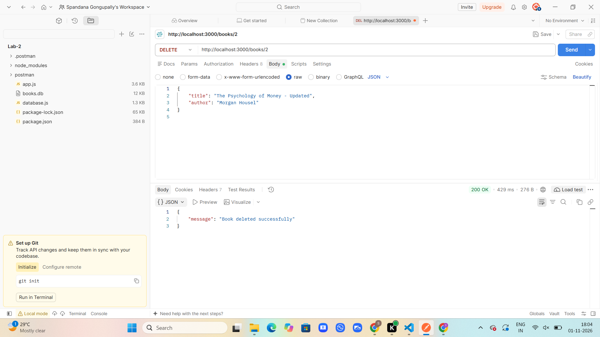

# Lab 2: SQLite database and CRUD routes

## Student Details
- **Name:** [GONGUPALLY SPANDANA]
- **Registration Number:** [252U1R6082]
- **Section:** [AIML-2B]

## Live Link
Not deployed yet. [Add your deployed public URL after deployment.]

## Project Description
This project connects an Express.js server to a SQLite database and provides REST API endpoints to perform CRUD operations on book records.

CRUD stands for:
- **Create:** Add a new book.
- **Read:** Retrieve book records.
- **Update:** Modify an existing book.
- **Delete:** Remove a book.

## Technologies Used
- Node.js
- Express.js
- SQLite
- JavaScript
- Postman

## Project Structure
```text
lab-02/
├── app.js
├── database.js
├── books.db
├── package.json
├── package-lock.json
├── .gitignore
├── README.md
├── screenshots/
│   ├── GET.png
│   ├── POST.png
│   ├── PUT.png
│   └── DELETE.png
└── .postman/
```

## Installation and Setup

### 1. Clone the repository
```bash
git clone YOUR_GITHUB_REPOSITORY_URL
```

### 2. Navigate to the project folder
```bash
cd lab-02
```

### 3. Install dependencies
```bash
npm install
```

### 4. Start the server
```bash
npm start
```

For development with automatic restart:
```bash
npm run dev
```

### 5. Access the server
```text
http://localhost:3000
```

### Environment Variables
- `PORT` – Port number used by the server. Defaults to `3000` locally.

## API Endpoints

| HTTP Method | Endpoint | Description |
|---|---|---|
| GET | `/books/` | Retrieves all books. |
| GET | `/books/:bookId/` | Retrieves a book by its ID. |
| POST | `/books/` | Adds a new book. |
| PUT | `/books/:bookId/` | Updates an existing book. |
| DELETE | `/books/:bookId/` | Deletes a book by its ID. |

## Screenshots

### GET – Retrieve Books


### POST – Add a Book


### PUT – Update a Book


### DELETE – Delete a Book


## Database
The project uses SQLite to store book records in the `books.db` database file.

SQL queries use parameterized placeholders (`?`) for user input to help prevent SQL injection.

## Notes
- All five CRUD API endpoints were implemented.
- API endpoints were tested using Postman.
- Database operations were checked using the SQLite CLI.
- `node_modules` is excluded from version control using `.gitignore`.